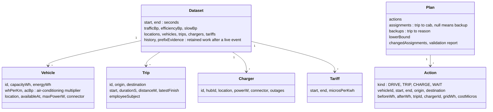
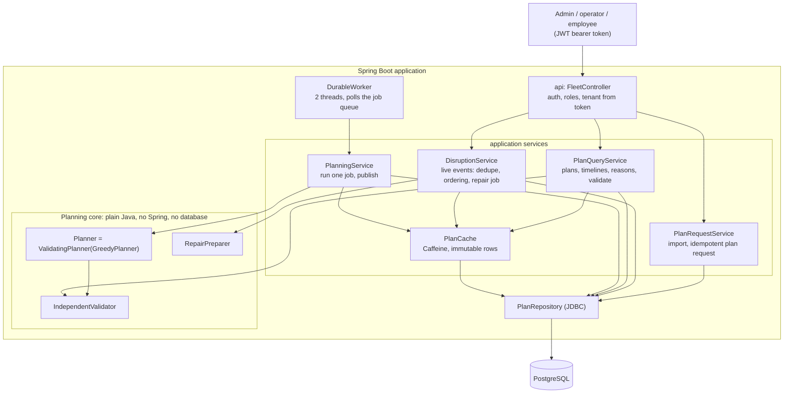
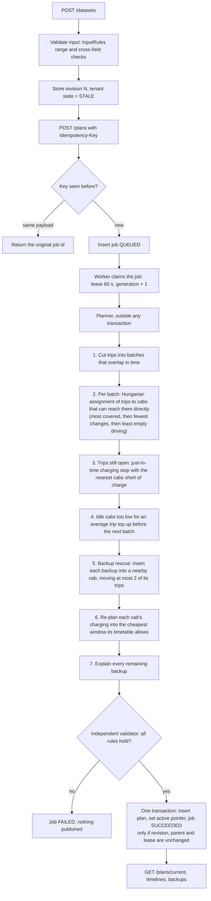

# EV Fleet Charging & Trip Assignment — Architecture (deep dive)

Java 17 · Spring Boot 3.5 · PostgreSQL 17 · one command: `docker compose up --build`

The two-page summary the brief asks for is [DESIGN-NOTE.md](DESIGN-NOTE.md) ([PDF](DESIGN-NOTE.pdf)). This document adds the full data model, both main
flows, the concurrency model, operations, the OOP structure and how the design evolved.

## 1. Problem and rules

Assign each shift trip to an electric cab and schedule charging so that:

| Hard rule (never broken) | How it is enforced |
|---|---|
| A cab's charge never drops below **15%**, including empty driving to a pickup or a charger | Every leg is checked when built; the independent validator re-checks every plan |
| A charger never has two cabs at once | Per-plug booking calendar; the validator re-checks every plug |
| Trips start on time and finish by their latest allowed time | Trips are fixed time windows; the validator re-checks them |

**Objective**, compared lexicographically: first **fewest trips on backup cabs**, then **lowest charging cost**. Live repairs add a middle step, **fewest
changed assignments**. Because the comparison is lexicographic, no amount of saved electricity can ever justify leaving a trip uncovered.

## 2. Data model

All quantities are integers in explicit units: watt-hours (Wh), watts (W), metres, seconds since the start of the day, and currency micro-units.



**Consumption** = distance × Wh/km × air-conditioning multiplier × traffic multiplier, rounded up.

**Charging curve** (two parts): full power up to 80% of the battery, then power × 0.35 above 80%, with 90% charger efficiency. Cost integrates grid
energy over every tariff window and every curve boundary.

**Storage.** PostgreSQL tables, every row keyed by tenant:

| Table | Holds |
|---|---|
| `ev6_state` | Per tenant: latest input revision, active plan, status (`CURRENT`, `STALE`, `INCIDENT`) |
| `ev6_datasets` | Each input revision as immutable JSON |
| `ev6_plans` | Each published plan as immutable JSON |
| `ev6_jobs` | Planning jobs: status, lease, generation |
| `ev6_events` | Live events: payload hash, sequence, outcome |
| `ev6_requests` | Plan-request idempotency keys |

The schema lives in `db/migration` and is applied by Flyway.

## 3. Architecture



**Layers.**

- `api` only translates HTTP to service calls.
- `application` holds the use cases.
- `persistence` holds SQL and the job queue.
- `planner`, `domain` and `validator` are the core. They import nothing from Spring or the database, so they can be run and unit-tested on their own:
  `Planner.standard().solve(dataset, 25, null)`.

**Object-oriented structure.**

| Principle | Where |
|---|---|
| Encapsulation | Immutable records (`Vehicle`, `Trip`, `Plan`, …) copy their lists. `ChargerCalendar` and `FleetSchedule` hide their bookings behind `reserve` / `release`. |
| Inheritance | `DomainException` has the subclasses `SafetyIncident` (always 409, code `SAFETY_INCIDENT_…`) and `RouteBlocked`. `ChargingStrategy` is an abstract class with the subclasses `JustInTime` and `CheapestWindow`, which override its default "charge only the minimum". `RequestObservability` extends Spring's `OncePerRequestFilter`. |
| Polymorphism | `Planner` has the implementations `GreedyPlanner` and the `ValidatingPlanner` decorator. `TravelProvider` lets a live map service replace `OfflineTravel`. `DisruptionKind` constants each implement `directlyImpacted`. `DisruptionService` catches `SafetyIncident` by type, and `ApiExceptionHandler` maps any `DomainException` through its `status()`. |
| Composition | `GreedyPlanner` is built from `BatchConstruction`, `BackupRescue`, `ChargingPasses` and `BackupExplainer`, which share one `PlanningRun`. |

## 4. Main flow: plan a day



## 5. Hardest flow: live re-plan (battery drift or charger failure)

```mermaid
sequenceDiagram
    participant O as Operator / telemetry
    participant D as DisruptionService
    participant DB as PostgreSQL
    participant RP as RepairPreparer
    participant W as DurableWorker
    participant PL as Planner + Validator
    O->>D: POST /disruptions (eventId, sequence, kind, asset, at)
    D->>DB: lock tenant state row
    D->>DB: event id seen? Same hash returns the first outcome, a different hash gets 409
    D->>DB: older than the last applied event for this asset? Store IGNORED_OLD
    D->>RP: freeze finished and imminent work, reopen the affected cab and the 2 nearest cabs
    alt unsafe observation: below floor, mid-trip, or unconfirmed charge
        D->>DB: tenant INCIDENT, no plan dispatchable
    else
        D->>DB: store revision N+1, job REPAIR queued (status STALE)
    end
    D-->>O: 202 ACCEPTED + jobId
    W->>DB: claim repair job (repairs before initial plans)
    W->>PL: solve with the previous plan as preference, 1.5 s budget
    Note over PL: keep a trip on its cab if a charging stop fits,<br/>otherwise move it; validate everything
    PL-->>W: validated plan
    W->>DB: one transaction: publish only if revision, parent and lease still match
    alt failed, not superseded
        W->>DB: queue one fallback full re-plan of the same revision
    end
```

**Minimal change.** Every cab outside the reopened neighbourhood keeps its whole future timeline and its charger bookings. Inside it, the planner keeps
trips on their original cab whenever a charging stop fits before the pickup. Measured: a mid-shift drift on the 300-cab day reassigns 0 trips.

## 6. API

| Method and path | Role | Purpose |
|---|---|---|
| `POST /api/v1/datasets` | admin | Import a shift (vehicles, trips, chargers, tariffs) |
| `POST /api/v1/plans` | admin, operator | Queue a plan (`Idempotency-Key` header, `budgetS`) |
| `GET /api/v1/jobs/{id}` | admin, operator | Job status and resulting plan id |
| `GET /api/v1/plans/current`, `/plans/{id}` | admin, operator | Plan, backup count, cost, lower-bound gap, dispatchable flag |
| `GET /api/v1/plans/{id}/timelines?vehicleId=` | admin, operator | Per-cab trips, drives, waits and charging, with charge before and after each |
| `GET /api/v1/plans/{id}/backups` | admin, operator | Reason and evidence for each backup trip |
| `POST /api/v1/plans/{id}/validate` | admin, operator | Re-run the independent validator |
| `POST /api/v1/disruptions` | admin, operator | Battery drift or charger failure |
| `GET /api/v1/me/trips` | any signed-in user | An employee's own upcoming trips only |
| `GET /health`, `/actuator/prometheus` | public, admin/operator | Liveness, metrics |

**Tenant isolation.** The tenant comes only from the signed token, and every query filters by it. Another tenant's plan returns 404.

**Errors.** Errors return `{"error":{"code":"..."}}` with no input echoed back and no personal data.

## 7. Failure modes

| What fails | What the user sees | How the system recovers |
|---|---|---|
| Worker crashes mid-publish | Job stays RUNNING, then is retried | Publish is one transaction (all or nothing); the lease expires and another claim re-runs it under a new generation |
| An old worker wakes up late | Nothing | Its generation and lease no longer match, so publishing is refused (`STALE_PUBLICATION`) |
| Duplicate request or event | The same job id or outcome as the first time | Idempotency key or event id plus payload hash; a different payload with the same id gets 409 |
| Out-of-order event | Status `IGNORED_OLD` | Sequence and time compared per asset |
| Event arrives during a pending repair | 409 `REPAIR_PENDING_OR_INCIDENT` | The client retries after the repair publishes |
| Repair planning fails | Plan shows `dispatchable=false` for a moment | One fallback full re-plan of the same revision is queued automatically |
| Unsafe observation (below 15%, mid-trip reading, unconfirmed interrupted charge) | `INCIDENT`; no plan offered as dispatchable | An operator re-imports the shift; publishing stays blocked until then |
| Planner runs out of time | Valid plan; untried trips listed as `SEARCH_BUDGET` backups | Every phase stops cleanly at the deadline |
| Database down | 503 `DATABASE_UNAVAILABLE` | Nothing is half-written; jobs resume after it returns |
| Planner bug produces an invalid plan | Job FAILED, previous plan stays active | The independent validator blocks publication |

## 7a. Concurrency model

- **Per tenant:** a row lock on `ev6_state` serialises writers.
- **Job claims:** `SELECT … FOR UPDATE SKIP LOCKED`.
- **Searching:** runs outside transactions.
- **Publishing:** compare-and-set on the revision, the active parent plan and the job generation.

This trades a little throughput for strong consistency. A plan is never published against input it did not see.

## 8. Algorithm, complexity and lower bound

| Phase | Work |
|---|---|
| Batch assignment | O(b·V) feasibility checks plus Hungarian O(b²·V′) per batch (b = trips in the batch, V′ = cabs that can reach any of them). Batches over 600 trips use a greedy pass. |
| Charging stop search | O(G·(P + K)) per probe, at most 40 probes per trip (G = charger groups, P = plugs in a group, K = tariff windows) |
| Backup rescue | At most 20 candidate cabs per backup, each with one day rebuild |
| Cheapest-window re-plan | One day rebuild per charging cab |
| Validator | O(A log A) for A actions |

Space is O(b·V) for the batch matrix plus O(A) for the plan.

**Lower bound.** Trips no cab could ever run, plus max(0, peak number of overlapping trips − number of cabs). The plan reports `backupGap` = backups −
lower bound.

**Measured** (Windows 11, Ryzen AI 9 HX 370; 300 cabs / 40 chargers / 1,500 trips; 10 seeds; end to end with PostgreSQL):

| Workflow | Limit | p50 | p99 |
|---|---|---|---|
| Initial plan | under 30 s | 0.15 s | 0.19 s |
| Battery-drift re-plan | under 2 s | 0.24 s | 0.36 s |
| Charger-failure re-plan | under 2 s | 0.25 s | 0.29 s |

- **300-cab day:** 0 backups, 100% of charging off-peak, ₹3,712–3,885 per day, 0 trips reassigned by either re-plan.
- **Harder rush-hour day:** 64–84 backups, each with a reason (charger congestion or not enough charge in time), planned in 0.08–0.12 s.
- **Scaling** (planner only, 2 s budget): 600 cabs / 3,000 trips in 0.18 s, 1,200 / 6,000 in 0.41 s (3 backups), 2,000 / 10,000 in 0.91 s (0 backups).
  The limit is the input cap, not time. Beyond it, the batch matrix (trips in a batch × cabs) and the per-plug calendar scans grow fastest.

## 9. Operations

- **Metrics** (Prometheus):
  - `evfleet.queue.depth`, `evfleet.queue.oldest.seconds` (lag)
  - `evfleet.jobs{outcome}`, `evfleet.http.responses{status}` (error rate)
  - `evfleet.rejections{reason}`, `evfleet.worker.retries`
  - `evfleet.deadline.misses`, `evfleet.end.to.end`, `evfleet.repair.fallbacks`
  - cache hit and miss counters
- **Logs:** Spring Boot structured JSON (Elastic Common Schema), with fields such as `event`, `tenant`, `jobId` and `endToEndMs`. No personal data.
- **Cache:** `PlanCache` (Caffeine) holds decoded plans and datasets. Those rows are never updated, so cached content cannot go stale. The active plan
  pointer and status are always read from the database. Eviction is by weight (about 75 MB) and 30 minutes after last access.

## 10. Trade-offs and what is left out

- **Consistency over availability:** one tenant's writes are serialised. A 409 during a pending repair is preferred over merging two plans.
- **Heuristic, not optimal:** batch-by-batch assignment and a depth-one backup rescue can miss better global arrangements. The lower bound reports how far
  from optimal the plan might be.
- **Exact rational arithmetic** in the planner (primitive `long`, switching to `BigInteger` only on overflow), so the planner and the validator agree to the
  watt-hour.
- **Left out:**
  - real road maps (straight-line distance with a traffic multiplier)
  - time-varying traffic
  - shared power limits per hub
  - battery ageing
  - queuing events during a pending repair
  - per-vehicle (rather than per-tenant) incidents
  - deletion of old revisions
  - multi-region failover

## 11. How the design evolved

The first working version met every hard rule, but measuring it showed where it was weak. Each change below was kept only when the benchmark
improved.

| Step | What we saw | What changed | Effect |
|---|---|---|---|
| 1. First greedy planner | Each trip went to the **first** cab (by id) that could do it. Cabs charged only when forced, so 541 of 545 sessions fell in peak hours. | Baseline | 0 backups on the 300-cab day, but ₹10.6–11.7k per day, 0% off-peak; 4.26 s / 4.86 s (p50 / p99) per plan |
| 2. Profiling | About 75% of the run time went into `BigInteger` fractions. That was fine for the 30 s limit, but the 2,000-cab test ran out of its 2 s budget: about 7 s of work for every 1,500 trips, so 2,999 of 10,000 trips became "out of time" backups. | `Fraction` on plain `long`, switching to `BigInteger` only on overflow (checked against `BigInteger` on 20,000 random cases). Identical chargers grouped. | Initial plan 0.20 s |
| 3. Assignment quality | First-feasible cab wasted charge on long empty drives. | Trips that overlap in time are assigned together by the **Hungarian algorithm** (least empty driving). Compared with a simple greedy "nearest cab" rule: Hungarian 0 / 0 / 0 backups vs greedy 3 / 0 / 1 on the 300-cab seeds, and 222 vs 227 on the rush-hour day, so Hungarian was kept. | Fewer backups on hard days |
| 4. Off-peak charging | Charging happened just before trips, at peak prices. | Cheapest-window pass: rebuild each cab's day so it buys energy in the cheapest window, keep it only if cheaper. | ₹3.7–3.9k per day, 100% off-peak |
| 5. Busy days | Rush-hour fixture (low starting charge, heavy traffic, busy plugs): 135–182 backups, all with one generic reason. | **Idle charging** after each batch, **backup rescue** local search, specific **backup reasons**. Without idle charging the 300-cab day had 16–21 backups and rush hour 488–649. | 64–84 explained backups |
| 6. Live re-plan | A drifted cab's trip was moved to another cab even when a short charge would have kept it; helpers were the cabs with the most charge, wherever they were. | Try charging the original cab first; reopen the 2 cabs **nearest** its next pickup. | 0 trips reassigned per drift |
| 7. Structure | One 600-line planner class; business rules inside the repository. | Planner split into one class per phase; service layer; Flyway; structured JSON logs; Caffeine plan cache; worker pool with repair fallback; exception and strategy subclasses. | Same results, easier to test and explain |
| 8. Tried and reverted | Bean Validation annotations on the input records. | Reverted to plain `if` checks in `InputRules`, which were easier to read. | — |
