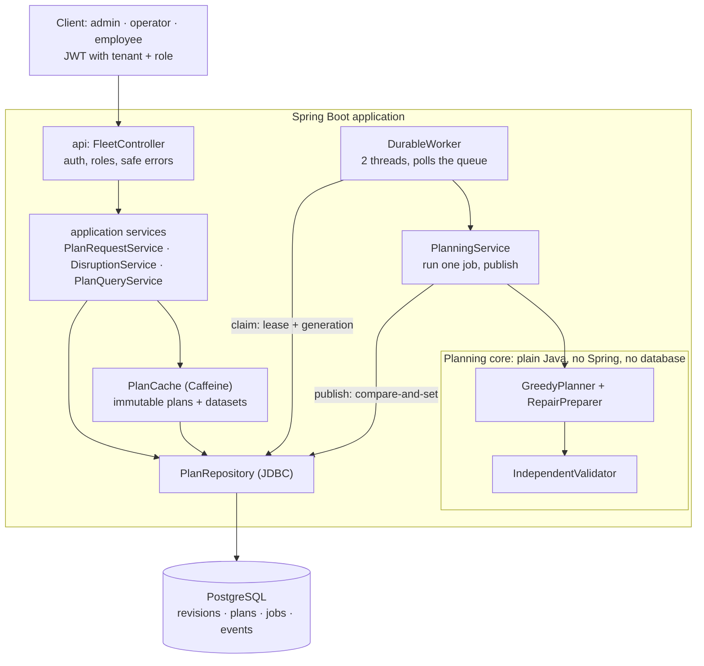
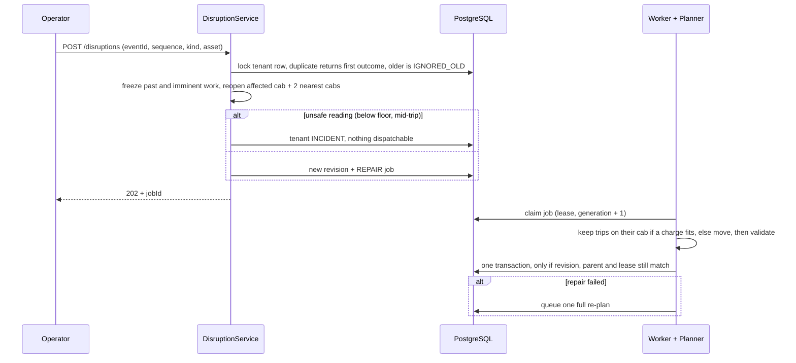

# EV Fleet Charging & Trip Assignment — Design Note

Java 17 · Spring Boot 3.5 · PostgreSQL 17 · run with `docker compose up --build` · printable two-page version: [DESIGN-NOTE.pdf](DESIGN-NOTE.pdf) · deep
dive: [ARCHITECTURE.md](ARCHITECTURE.md)

## 1. Problem, rules and objective

Assign every shift trip to an electric cab and schedule its charging.

**Hard rules**, checked as each plan is built and checked again by an independent validator before any plan is published:

- a cab never drops below **15%** charge, including empty driving to a pickup or a charger;
- a charger never serves two cabs at once;
- every trip starts on time.

**Objective**, compared in order: **fewest backup trips**, then **lowest charging cost**. A live re-plan adds **fewest changed assignments** between
the two. Because the comparison is in order rather than weighted, saving money can never justify leaving a trip uncovered.

## 2. Data model

All values are integers with the unit in the name: Wh, W, metres, seconds, currency micro-units.

| Record | Key fields |
|---|---|
| `Vehicle` | capacityWh, energyWh, whPerKm, AC multiplier, location, availableAt, maxPowerW, connector |
| `Trip` | origin, destination, start, durationS, distanceM, latestFinish, employee |
| `Charger` | hub, location, powerW, connector, outages |
| `Tariff` | start, end, price per kWh (peak / off-peak) |
| `Dataset` | one shift: the four above + traffic multiplier, charging curve (full power to 80%, ×0.35 above, 90% efficiency) |
| `Plan` | actions (DRIVE, TRIP, CHARGE, WAIT, each with charge before/after), assignments, backups with reasons, lower bound, validation |

PostgreSQL (schema by Flyway), every row keyed by tenant: `ev6_state` (active plan, status), `ev6_datasets` and `ev6_plans` (immutable JSON revisions),
`ev6_jobs` (queue with lease), `ev6_events` and `ev6_requests` (idempotency).

## 3. Architecture

Layers: `api` → `application` → `planner` / `domain` / `validator` (no Spring, no database) and `persistence`. The core runs alone:
`Planner.standard().solve(dataset, 25, null)`.

## 4. API (all under `/api/v1`, tenant always taken from the token)

| Endpoint | Role | Purpose |
|---|---|---|
| `POST /datasets` | admin | import a shift |
| `POST /plans` · `GET /jobs/{id}` | admin, operator | queue a plan (Idempotency-Key) and poll it |
| `GET /plans/current` · `/plans/{id}` | admin, operator | plan, backups, cost, lower-bound gap, dispatchable |
| `GET /plans/{id}/timelines` · `/backups` | admin, operator | per-cab timeline with charge at each step · why each trip is unassigned |
| `POST /plans/{id}/validate` | admin, operator | re-run the independent validator |
| `POST /disruptions` | admin, operator | battery drift or charger failure |
| `GET /me/trips` | employee | own upcoming trips only |

## 5. Hardest flow: live re-plan

## 6. Algorithm, complexity, lower bound

1. Cut trips into **batches** that overlap in time. Assign each batch with the **Hungarian algorithm**, O(b²·V′), where b = trips in the batch and V′ =
   cabs that can reach one of them. The cost ranks covered first, then unchanged (on repair), then least empty driving.
2. Trips no cab reaches directly get a **just-in-time charging stop**, at most 40 probes of O(G·(P+K)), where G = charger groups, P = plugs and K =
   tariff windows.
3. **Idle charging** after each batch tops up cabs that are too low for an average trip.
4. **Local search:** each backup is offered to up to 20 nearby cabs, which may hand up to 2 trips to others. Then each cab's charging is moved to its
   **cheapest window**, and the change is kept only if it is cheaper.
5. Each remaining backup gets a **reason** such as `CHARGER_CONGESTION` or `NO_CAB_WITH_ENOUGH_CHARGE_IN_TIME`, with evidence.

**Lower bound:** trips no cab could ever run, plus max(0, peak overlapping trips − cabs). The plan reports `backupGap` = backups − bound.

**Measured** (Ryzen AI 9 HX 370, Windows 11; 300 cabs / 40 chargers / 1,500 trips; 10 seeds; end to end through PostgreSQL):

| | Limit | p50 | p99 |
|---|---|---|---|
| Initial plan | 30 s | 0.15 s | 0.19 s |
| Battery-drift re-plan | 2 s | 0.24 s | 0.36 s |
| Charger-failure re-plan | 2 s | 0.25 s | 0.29 s |

Results:

- **300-cab day:** 0 backups, 100% of charging off-peak, 0 trips reassigned by either re-plan.
- **Harder rush-hour day:** 64–84 backups, each explained.
- **Scaling:** 2,000 cabs / 10,000 trips in 0.91 s.

## 7. Failure modes

| Failure | User sees | Recovery |
|---|---|---|
| Worker crashes while publishing | job retried | publish is one transaction; lease expires, job re-claimed |
| Late worker with an expired lease | nothing | generation fencing refuses the publish |
| Duplicate request or event | same job / outcome as before | idempotency key or event id + payload hash; changed payload → 409 |
| Out-of-order event | `IGNORED_OLD` | per-asset sequence check |
| Repair fails | plan briefly not dispatchable | one fallback full re-plan queued automatically |
| Unsafe reading | `INCIDENT` | publishing blocked until the shift is re-imported |
| Planner out of time | valid plan, `SEARCH_BUDGET` backups | every phase stops cleanly at the deadline |
| Database down | 503 `DATABASE_UNAVAILABLE` | nothing half-written; work resumes after recovery |
| Planner bug | job FAILED, old plan stays | the validator blocks publication |

## 8. Trade-offs and what is left out

- **Consistency over throughput:** one writer per tenant at a time. An event during a pending repair gets 409 instead of being merged.
- **Heuristic, not optimal:** the lower bound states how far off the plan might be; on the rush-hour day the bound is weak.
- **Cache:** plans and datasets never change once saved, so cached copies cannot be stale. The active plan pointer is never cached.
- **Security:** HS256 JWT with tenant and role claims. Errors carry codes only, never input or personal data.
- **Left out:** real road maps and live traffic (straight-line distance × traffic factor), hub power limits, battery ageing, per-cab incidents, queuing
  events during a repair, multi-region failover.
